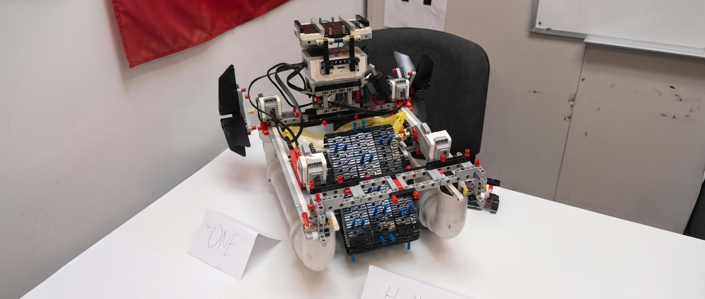
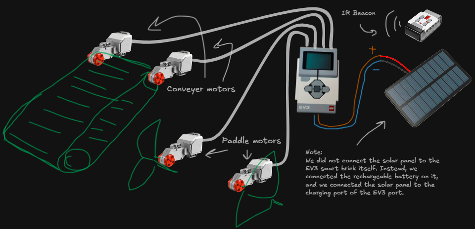

# HydroEcoCleaner

## What is this?

This is a robot designed to clean floating trash from water surfaces. It is inspired by the The Ocean Cleanup's Interceptor. We designed it specifically to make it cheaper and more aligned for smaller water bodies.

### Features
  - Conveyor belt for large pieces
  - Net for smaller pieces
  - Solar panel for charging
  - Differential thrust for movement
  - Remote control
  - Low power usage

---

## Why?

Kyrgyzstan has a lot of small water bodies that are unfortunately riddled with trash. This in turn damages the natural habitat of animals and negatively affects plant growth. The HydroEcoCleaner is designed to specifically fight against that. It is designed to be small enough to maneuver tight spots, while also being cheap. The solar panel also allows it to run for an extended amount of time.

There was once a project competition coming up and we needed a project. We started developing one. It slowly started growing on us, so we decided to continue developing on it after our first competition. After refining, we went to an international competition called Infomatrix Asia 2025, where we won bronze. Next, we went to the ISMART Robot Olympiad after making a few changes, where we won 1st place.

---

## Extra

For this project I was responsible for for Hardware. More specifically, I was the one to come up with charging using a solar panel, using differential thrust, and the weight balance. Also, we had never made a GitHub repository for the project, so this repository is made by me from existing material/recreated material.

---

## Component stuff

