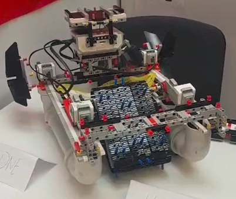

# HydroEcoCleaner (DISCONTINUED)

## What is this?

This is a robot designed to clean floating trash from water surfaces. It is inspired by the The Ocean Cleanup's Interceptor. We designed it specifically to make it cheaper and more aligned for smaller water bodies.

### Features
  - Conveyor belt for large pieces
  - Net for smaller pieces
  - Solar panel for charging
  - Differential thrust for movement
  - Remote control

---

## Why?

Kyrgyzstan has a lot of small water bodies that are unfortunately riddled with trash. This in turn damages the natural habitat of animals and negatively affects plant growth. The HydroEcoCleaner is designed to specifically fight against that. It is designed to be small enough to maneuver tight spots. The solar panel also allows it to run for an extended amount of time.

There was once a project competition coming up and we needed a project. We started developing one. It slowly started growing on us, so we decided to continue developing on it after our first competition. After refining, we went to an international competition called Infomatrix Asia 2025, where we won bronze. Next, we went to the ISMART Robot Olympiad after making a few changes, where we won 1st place. The project is in its prototype and following the separation of the team, the project has been left discontinued.

---

## Extra

For this project I was responsible for for Hardware. More specifically, I was the one to come up with charging using a solar panel, using differential thrust, and the weight balance. Also, we had never made a GitHub repository for the project, so this repository is made by me from existing material/recreated material.

---

## Component stuff

Solar panel wire connections
| # | From Component | From Terminal | To Component | To Terminal | Wire Color |
|---:|---|---|---|---|---|
| 1 | Solar Panel | Positive (+) | DROK 180078 | IN+ | Red |
| 2 | Solar Panel | Negative (−) | DROK 180078 | IN− | Black |
| 3 | DROK 180078 | OUT+ | 1N5822 Diode | Anode (Unbanded End) | Red |
| 4 | 1N5822 Diode | Cathode (Banded End) | DC Charging Connector | Positive (+) | Red |
| 5 | DROK 180078 | OUT− | DC Charging Connector | Negative (−) | Black |
| 6 | DC Charging Connector | Charging Plug | LEGO 45501 Battery | Charging Port | White |
| 7 | LEGO 45501 Battery | Battery Connection | EV3 Intelligent Brick | Battery Compartment | White |

Here, the solar panel converts sunlight into electrical energy. This electricity passes through the DROK 180078 voltage regulator, which adjusts the voltage and limits the output current. The 1N5822 Schottky diode helps prevent electricity from flowing backwards through the circuit. The electricity reaches the LEGO EV3 45501 battery through its charging connector to charge.

## BOM

All prices are estimated in USD.

## Lego EV3 stuff

| # | Component | Model | Quantity | Unit Price (USD) | Total (USD) |
|---:|---|---|---:|---:|---:|
| 1 | EV3 Intelligent Brick | LEGO 45500 | 1 | 63.00 | 63.00 |
| 2 | EV3 Rechargeable Battery | LEGO 45501 | 1 | 79.00 | 79.00 |
| 3 | EV3 Large Servo Motor | LEGO 45502 | 4 | 19.99 | 79.96 |
| 4 | IR Beacon | LEGO 45508 | 1 | 28.00 | 28.00 |
| 5 | IR Sensor | LEGO 45509 | 1 | 22.00 | 22.00 |
| 6 | EV3 Cable Pack | LEGO 45514 | 1 | 15.99 | 15.99 |

## Solar panel stuff

| # | Component | Model | Quantity | Unit Price (USD) | Total (USD) |
|---:|---|---|---:|---:|---:|
| 7 | Solar Panel (20W, 12V) | ACOPOWER HY020-12M | 1 | 39.50 | 39.50 |
| 8 | DC-DC Buck Converter | DROK 180078 | 1 | 20.50 | 20.50 |
| 9 | Schottky Diode | 1N5822 | 1 | 0.71 | 0.71 |
| 10 | DC Charging Connector | Compatible connector | 1 | 2.00 | 2.00 |
| 11 | Electrical Wiring | 18 AWG / 20 AWG | 1 lot | 5.00 | 5.00 |

## Other components

| # | Component | Specification | Quantity | Unit Price (USD) | Total (USD) |
|---:|---|---|---:|---:|---:|
| 12 | Technic Beams, Pins, Axles and Gears | LEGO Technic assortment | 1 lot | 30.00 | 30.00 |
| 13 | Conveyor Belt and Rollers | Custom/LEGO-compatible | 1 assembly | 10.00 | 10.00 |
| 14 | Paddle Blades and Mounts | Custom/LEGO-compatible | 2 assemblies | 2.50 | 5.00 |

## Cost Summary

| Category | Total (USD) |
|---|---:|
| Lego EV3 stuff | 287.95 |
| Solar panel stuff | 67.71 |
| Other components | 45.00 |
| **Grand Total** | **400.66** |

> Note: Prices are preliminary estimates based on online listings and market valuations. Mechanical component costs, wiring and connector prices are budget allowances. Shipping, import fees and taxes are excluded. Just in case.

## Another version of the HEC (without solar panel)

